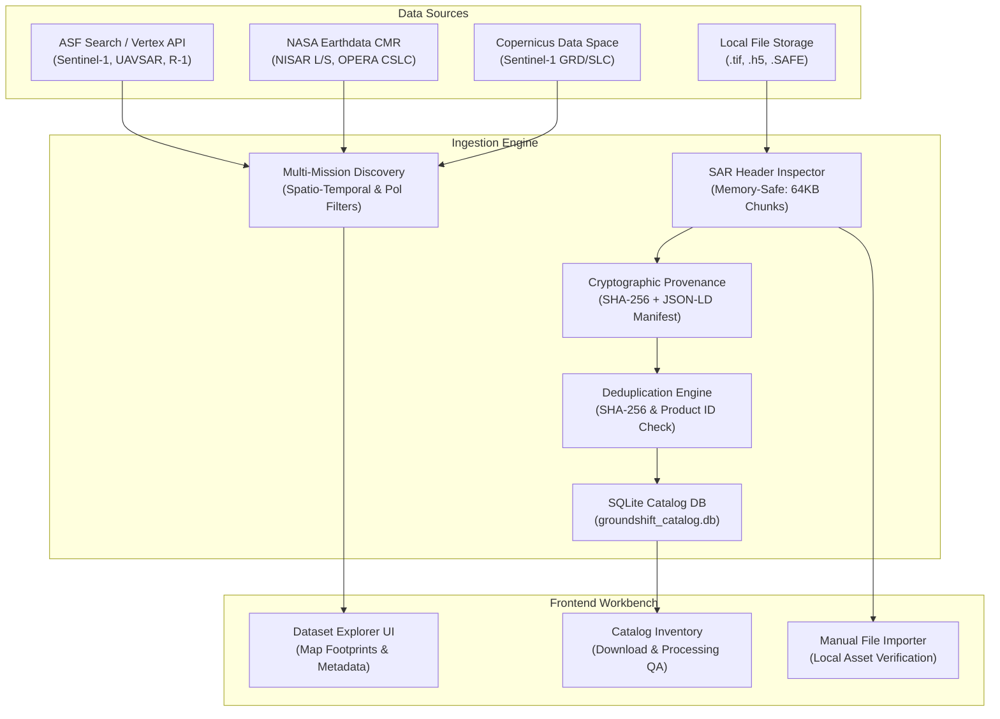

# GROUNDSHIFT Multi-Mission SAR Data Ingestion Engine

## 1. Architectural Overview

The **GROUNDSHIFT Multi-Mission SAR Data Ingestion Engine** is a scientifically reliable, product-aware discovery, inspection, and cataloguing subsystem engineered for cross-mission Synthetic Aperture Radar (SAR) validation. It bridges NASA Earthdata, ASF DAAC, Copernicus Data Space Ecosystem (CDSE), and Canadian/Argentine SAR holdings.



---

## 2. Supported Satellite & Airborne Missions

| Mission | Radar Band | Center Frequency | Polarimetric Modes | Primary Product Types | Native Container |
| :--- | :---: | :---: | :---: | :---: | :---: |
| **NISAR L-band** | L-band | 1.257 GHz (23.8 cm) | HH, HV, VV, VH, Quad-pol | L0B, RSLC, GCOV, GSLC, GUNW | HDF5 (`.h5`) |
| **NISAR S-band** | S-band | 3.200 GHz (9.3 cm) | HH, HV, VV, VH, Quad-pol | L0B, RSLC, GCOV, GSLC | HDF5 (`.h5`) |
| **Sentinel-1 (A/B/C)** | C-band | 5.405 GHz (5.55 cm) | VV, VH, HH, HV, Dual-pol | RAW (L0), SLC (L1), GRD (L1), OCN (L2) | SAFE directory / Zip |
| **SAOCOM (1A/1B)** | L-band | 1.275 GHz (23.5 cm) | SP (HH/VV), DP (HH/HV), QP (Quad) | L1A (SLC), L1B (DGM/GEC), L1C (GTC), L1D | HDF5 / GeoTIFF |
| **RADARSAT-1** | C-band | 5.300 GHz (5.66 cm) | HH (Single-pol) | RAW, SLC, SGF, SGX, SCW | CEOS / GeoTIFF |
| **RADARSAT Constellation (RCM)** | C-band | 5.405 GHz (5.55 cm) | Circular/Compact Pol, Dual, Quad | GRD, SLC, GCD | GeoTIFF + XML |
| **UAVSAR** | L-band | 1.257 GHz (23.8 cm) | Full Quad-pol (HHHH, HVHV, etc.) | SLC, MLC, DAT, HGT, InSAR Unwrapped | HDF5 / Flat Binary + `.ann` |

---

## 3. Core Scientific Ingestion Rules

1. **Strict Product Segregation**:
   - **GRD (Ground Range Detected)**: Intensity/amplitude detected only; complex radar phase is permanently discarded.
   - **SLC / RSLC (Single Look Complex)**: Preserves in-phase ($I$) and quadrature ($Q$) complex channels for interferometry and polarimetry.
   - **GUNW (Geocoded Unwrapped InSAR)**: Unwrapped phase and Line-of-Sight deformation fields ($L3$).
   - **GCOV (Geocoded Covariance)**: Multilooked polarimetric covariance matrix elements ($\mathbf{C}_3$ or $\mathbf{C}_4$).
   - *Rule Violation Prohibition*: The ingestion engine strictly rejects any cross-assignment or conversion that treats GRD backscatter as an interferometric phase product.

2. **No Data Fabrication**:
   - Zero synthetic radar measurements are fabricated. When querying DAAC endpoints, results reflect genuine archive inventories.
   - Offline benchmark scenes are explicitly labeled with `provenance_tag: "OFFLINE_REFERENCE_CATALOGUE"` to maintain research integrity.

3. **No Authentication Bypass**:
   - NASA Earthdata, Copernicus CDSE, and ISRO Bhoonidhi access restrictions are respected. The system provides direct canonical download endpoints with Earthdata token authentication guides or manual local import workflows.

4. **16 GB RAM Boundary Memory Safety**:
   - Raster inspection is performed via header-only reads (`rasterio.open` bounds/tags extraction; `h5py.File` group hierarchy inspection; `manifest.safe` XML parsing).
   - Cryptographic SHA-256 calculation streams in 64 KB blocks, ensuring 10+ GB satellite scenes never cause Out-Of-Memory (OOM) crashes.

---

## 4. API Endpoints Reference

The ingestion router is mounted at `/api/v1/ingest`:

| Method | Endpoint | Description |
| :--- | :--- | :--- |
| `GET` | `/api/v1/ingest/search` | Query remote mission DAACs by bounding box, dates, mission, product type, polarization, and processing level. |
| `POST` | `/api/v1/ingest/inspect` | Inspect local file or directory (`.tif`, `.h5`, `.SAFE`) without loading pixel matrices into RAM. |
| `POST` | `/api/v1/ingest/inspect-upload` | Upload and inspect a sample SAR asset in the raw staging directory. |
| `POST` | `/api/v1/ingest/import-local` | Ingest local file into catalog: computes SHA-256 hash, runs integrity verification, and generates JSON-LD provenance. |
| `POST` | `/api/v1/ingest/register-remote` | Register a discovered remote dataset in the local catalog to track acquisition status. |
| `GET` | `/api/v1/ingest/catalog` | List catalogued SAR scenes with filtering by mission, product type, or download status. |
| `GET` | `/api/v1/ingest/catalog/{product_id}` | Retrieve comprehensive technical metadata and cryptographic provenance manifest. |
| `DELETE` | `/api/v1/ingest/catalog/{product_id}` | Remove a scene record from the local SQLite catalog. |
| `GET` | `/api/v1/ingest/stats` | Aggregated catalog summary: scene count, disk footprint (MB/GB), breakdown by mission/status. |
| `POST` | `/api/v1/ingest/seed-reference-samples` | Seed verified sample metadata across all 7 missions over Chennai and Cauvery Delta study areas. |

---

## 5. Provenance Manifest Schema (JSON-LD)

Every ingested asset generates an immutable, reproducible JSON-LD provenance record:

```json
{
  "@context": "https://groundshift.earth/context/v1.jsonld",
  "id": "S1A_IW_SLC__1SDV_20240112T124530_TEST",
  "type": "ProvenanceRecord",
  "timestamp": "2026-11-15T13:10:00Z",
  "classification": "OBSERVABLE_MEASURED",
  "algorithm": {
    "name": "GROUNDSHIFT_SAR_INSPECTION_ENGINE",
    "version": "1.0.0",
    "parameters": {
      "format_detected": "SAFE",
      "sensor_band": "C",
      "polarization": "VV+VH",
      "integrity_checks": {
        "file_count": 28,
        "measurement_files_count": 2,
        "measurement_dir_exists": true
      }
    }
  },
  "sources": [
    {
      "local_path": "D:\\groundshift\\data\\raw\\S1A_IW_SLC__1SDV.SAFE",
      "file_size_bytes": 1073741824,
      "sha256": "8a3f89e...canonical_hash"
    }
  ],
  "environment": {
    "platform": "GROUNDSHIFT-Win11",
    "runtime": "Python 3.11"
  }
}
```

---

## 6. Verification & Automated Testing

All 20 test cases run and pass under `pytest`:

```powershell
$env:PYTHONPATH = "d:\groundshift"
& "C:\Users\jeyak\miniforge3\envs\groundshift\python.exe" -m pytest
```

- `tests/test_sar_inspector.py`: Verifies GeoTIFF, HDF5, and `.SAFE` header inspection, bounding box extraction, and zero-byte/corrupt file detection.
- `tests/test_ingestion_catalog.py`: Verifies catalog SQLite CRUD, deduplication, spatial search queries, and stats aggregation.
- `tests/test_physics.py`: Verifies 2D LOS vector decomposition and phase triplet loop closure audits.
- `tests/test_health.py`: Verifies host memory governor and scientific library environment sanity.

