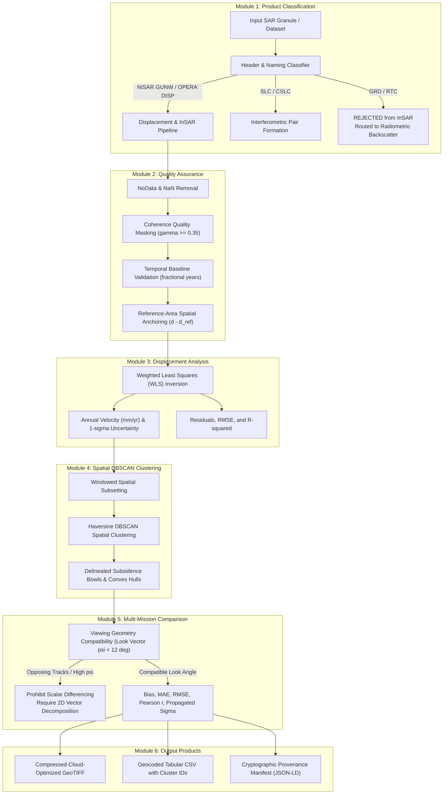

# GROUNDSHIFT Scientific SAR Processing Engine

## 1. Architectural Overview & Physics Foundation

The **GROUNDSHIFT Scientific SAR Processing Engine** executes mathematically rigorous, reproducible radar geodesy and surface change analysis. Engineered for cross-mission compatibility across NASA-ISRO NISAR, Copernicus Sentinel-1, SAOCOM, RADARSAT Constellation, and UAVSAR, it enforces physical viewing geometry constraints and prevents invalid cross-product operations.



---

## 2. Mathematical Formulations

### 2.1 1D Line-of-Sight (LOS) Projection
Radar measures scalar displacement along the satellite Line-of-Sight ($\mathbf{d}_{LOS}$):
$$d_{LOS} = -d_{east}\sin\theta\cos\alpha + d_{north}\sin\theta\sin\alpha + d_{up}\cos\theta$$
where $\theta$ is the local radar incidence angle and $\alpha$ is the satellite flight heading angle (azimuth).
*Rule:* Single-track LOS cannot be directly scaled by $1/\cos\theta$ to produce vertical subsidence without opposing track decomposition or an in-situ GNSS constraint.

### 2.2 Weighted Least-Squares (WLS) Velocity Inversion
For an unwrapped displacement time series $\mathbf{d} = [d_0, d_1, \dots, d_{N-1}]^T$ at epochs $\mathbf{t} = [t_0, t_1, \dots, t_{N-1}]^T$:
$$\mathbf{d} = \mathbf{G}\mathbf{m} + \boldsymbol{\epsilon}, \quad \mathbf{G} = \begin{bmatrix} 1 & t_0 \\ 1 & t_1 \\ \vdots & \vdots \\ 1 & t_{N-1} \end{bmatrix}, \quad \mathbf{m} = \begin{bmatrix} d_0 \\ v \end{bmatrix}$$
The weighted normal equations:
$$\hat{\mathbf{m}} = (\mathbf{G}^T \mathbf{W} \mathbf{G})^{-1} \mathbf{G}^T \mathbf{W} \mathbf{d}$$
where $\mathbf{W} = \text{diag}(1/\sigma_i^2)$ represents the observational weight matrix derived from interferometric coherence or unwrapping uncertainty.

### 2.3 Parameter Uncertainty & Goodness of Fit
$$\mathbf{\Sigma}_m = \sigma_0^2 (\mathbf{G}^T \mathbf{W} \mathbf{G})^{-1}, \quad \sigma_0^2 = \frac{\mathbf{r}^T \mathbf{W} \mathbf{r}}{N - 2}, \quad \sigma_v = \sqrt{\mathbf{\Sigma}_{m, 1, 1}}$$
$$R^2 = 1 - \frac{\sum r_i^2}{\sum (d_i - \bar{d})^2}$$

### 2.4 DBSCAN Spatial Clustering (Haversine Spherical Metric)
To cluster contiguous deformation zones on a spherical Earth without map distortion:
$$D_{ij} = 2 R \arcsin\left(\sqrt{\sin^2\left(\frac{\Delta \phi}{2}\right) + \cos\phi_1\cos\phi_2\sin^2\left(\frac{\Delta \lambda}{2}\right)}\right)$$
Points satisfying $|v| \ge v_{threshold}$ with at least $N_{min}$ neighbors within radius $\epsilon$ are merged into discrete subsidence bowls with calculated convex hull boundaries, surface areas ($\text{km}^2$), and peak velocities.

### 2.5 Multi-Mission Geometric Compatibility
Unit line-of-sight vectors $\hat{\mathbf{e}}_1$ and $\hat{\mathbf{e}}_2$:
$$\cos\psi = \hat{\mathbf{e}}_1 \cdot \hat{\mathbf{e}}_2$$
If $\psi > 12^\circ$ or if tracks are opposing (Ascending vs Descending), direct scalar differencing is scientifically invalid and rejected.

---

## 3. Core Modules & Files

| Module | Source File | Core Capabilities |
| :--- | :--- | :--- |
| **Module 1: Product Classification** | `processing/product_classifier.py` | Classifies SLC, GRD, NISAR GUNW/GCOV, OPERA DISP; validates phase preservation and workflow permissions. |
| **Module 2: Quality Assurance** | `processing/quality_assurance.py` | Detects NoData/NaNs, enforces coherence masks ($\gamma \ge 0.35$), validates chronological epochs, applies spatial reference anchor offset. |
| **Module 3: Displacement Analysis** | `processing/displacement_engine.py` | Inverts time-series into linear rate ($v$ in mm/yr), analytical standard error $\sigma_v$, RMSE, $R^2$, and residuals via WLS. |
| **Module 4: Spatial Analysis** | `processing/spatial_analysis.py` | Subsetting, valid-pixel extraction, and spherical Haversine DBSCAN clustering to identify subsidence bowls. |
| **Module 5: Multi-Mission Comparison** | `processing/multi_mission_comparator.py` | Computes 3D look-vector divergence, removes datum bias, and calculates Bias, MAE, RMSE, Pearson $r$, and propagated uncertainty. |
| **Module 6: Raster Exporter** | `processing/raster_exporter.py` | Memory-efficient GeoTIFF export (tiled, DEFLATE compressed, multiple-of-16 block sizes) and geocoded tabular CSV with cryptographic lineage. |
| **API Endpoints** | `backend/app/api/v1/processing.py` | REST endpoints mounted under `/api/v1/processing`. |
| **UI Workbench** | `frontend/src/pages/ProcessingPage.tsx` | Interactive React + Leaflet + Plotly scientific workbench with 4 dedicated processing panels. |

---

## 4. Verification & Automated Pytest Suite

All 35 automated scientific and system tests pass:

```powershell
$env:PYTHONPATH = "d:\groundshift"
& "C:\Users\jeyak\miniforge3\envs\groundshift\python.exe" -m pytest tests/ -v
```

- `tests/test_sar_processing.py`: 15 comprehensive unit & integration tests covering all 6 processing engine modules.
- `tests/test_sar_inspector.py`: 4 tests for GeoTIFF, HDF5, and Sentinel-1 `.SAFE` parsing.
- `tests/test_ingestion_catalog.py`: 4 tests for database CRUD, discovery search, and statistics.
- `tests/test_physics.py`: 7 tests for 2D LOS vector decomposition and phase triplet loop closure audits.
- `tests/test_health.py`: 5 tests for memory safety bounds and scientific libraries.

