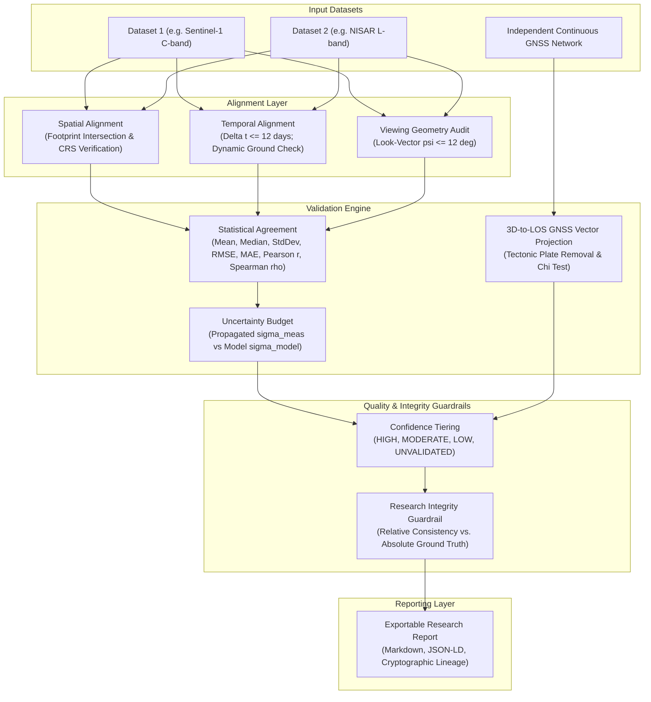

# GROUNDSHIFT Multi-Mission Validation & Comparison Engine

## 1. Architectural Overview & Geodetic Principles

The **GROUNDSHIFT Multi-Mission Validation and Comparison Engine** establishes a mathematically rigorous protocol to evaluate the consistency, quality, and uncertainty of SAR measurements across divergent satellite missions (e.g. Sentinel-1, NISAR, SAOCOM, RCM, UAVSAR).



---

## 2. Core Methodological Modules

### 2.1 Spatial Alignment
- **Footprint Intersection**: Computes exact geographic polygon intersection using `shapely`.
- **CRS Check**: Verifies whether coordinate reference systems match (e.g. WGS84 EPSG:4326 vs UTM Zone 44N EPSG:32644) and checks whether reprojection is required.
- **Scientific Resampling Policy**: Resampling is executed only when scientifically justified. The higher-resolution dataset is resampled onto the grid of the coarser dataset to preserve statistical degrees of freedom and avoid interpolative artifacts.

### 2.2 Temporal Alignment
- **Temporal Separation ($\Delta t$):** Evaluates $|t_1 - t_2|$ in days.
- **Dynamic Ground Condition Guardrail:** Never assumes observations from different dates represent identical ground conditions. Flags temporal separation $> 12$ days as vulnerable to unmodeled physical variations (groundwater extraction, soil moisture, post-precipitation swelling).

### 2.3 Viewing Geometry Audit
- **3D Unit Look-Vector Divergence ($\psi$):**
  $$\cos\psi = \hat{\mathbf{e}}_1 \cdot \hat{\mathbf{e}}_2$$
- Scalar differencing or averaging of opposing Ascending vs. Descending tracks ($\psi \approx 180^\circ$) is strictly prohibited without 2D vector decomposition.
- When $\psi > 12^\circ$, scalar differencing is flagged as geometrically incompatible because measurements project differing ratios of horizontal and vertical strain.

### 2.4 Statistical Agreement Metrics
Calculated over $N \ge 3$ co-located valid points:
- **Mean Difference (Bias):** $\frac{1}{N}\sum(d_1 - d_2)$ (evaluates datum/reference frame shift).
- **Median Difference:** Robust central tendency, insensitive to unwrapping outliers.
- **Standard Deviation ($\sigma_{\Delta}$):** $\sqrt{\frac{1}{N-1}\sum(\Delta_i - \bar{\Delta})^2}$.
- **Root Mean Square Error (RMSE):** $\sqrt{\frac{1}{N}\sum(d_1 - d_2)^2}$.
- **Mean Absolute Error (MAE):** $\frac{1}{N}\sum|d_1 - d_2|$.
- **Pearson Correlation ($r$):** Linear parametric correlation with p-value.
- **Spearman Rank Correlation ($\rho$):** Non-parametric monotonic correlation.
- **Coefficient of Determination ($R^2$):** Proportion of variance shared between sensors.

### 2.5 Uncertainty Budget & Separation
- **Measurement Uncertainty ($\sigma_{meas}$):** Propagates analytical radar phase noise:
  $$\sigma_{\Delta} = \sqrt{\sigma_1^2 + \sigma_2^2}$$
- **Model Scatter Uncertainty ($\sigma_{model}$):** Empirical standard error of residuals ($\sigma_{\Delta} / \sqrt{N}$).
- **Missing Uncertainty Detection:** Flags datasets lacking formal variance metadata with `UNCERTAINTY_METADATA_MISSING`.

### 2.6 Independent In-Situ GNSS Benchmark Validation
Continuous GNSS stations in Chennai (CHN1 IGS, OMR Sholinganallur Subsidence benchmark) and the Cauvery Delta (THNJ) provide absolute physical ground truth.
- Rigid tectonic plate motion (Indian Plate $\approx 42\text{ mm/yr}$ East, $31\text{ mm/yr}$ North) is subtracted.
- 3D velocity $[v_e, v_n, v_u]$ is projected into satellite Line-of-Sight:
  $$v_{GNSS, LOS} = -v_e\sin\theta\cos\alpha + v_n\sin\theta\sin\alpha + v_u\cos\theta$$
- Evaluates the normalized discrepancy statistic:
  $$\chi = \frac{|v_{SAR, LOS} - v_{GNSS, LOS}|}{\sqrt{\sigma_{SAR}^2 + \sigma_{GNSS}^2}}$$
  If $\chi \le 2.0$, agreement is verified within the $95\%$ confidence interval.

---

## 3. Strict Research Integrity Rules

1. **Relative Consistency vs. Absolute Truth:**
   Cross-mission agreement between satellite sensors demonstrates relative observational consistency under shared geometry, but does **NOT** constitute proof of absolute accuracy.
2. **Validation Classification Guardrail:**
   Comparisons between two satellite products are labeled `INTER_MISSION_CONSISTENCY_CHECK`, **NEVER** `IN_SITU_GROUND_TRUTH_VALIDATION`. True validation is only awarded when tested against independent ground benchmarks (GNSS, leveling, extensometers).
3. **No Invented Statistics:**
   Zero statistical values are fabricated. All metrics are computed from real co-located observation matrices.

---

## 4. Confidence Tiering Criteria

| Confidence Tier | Required Criteria |
| :--- | :--- |
| **HIGH CONFIDENCE** | Independent GNSS ground truth present, both inputs have formal $\sigma$, $\Delta t \le 6$ days, look-angle difference $\psi \le 5^\circ$, $N \ge 20$. |
| **MODERATE CONFIDENCE** | Independent ground truth present, formal $\sigma$ present, $\Delta t \le 24$ days, look-angle difference $\psi \le 10^\circ$. |
| **MODERATE CONSISTENCY** | Inter-mission satellite comparison (no GNSS), formal $\sigma$ present, $\Delta t \le 12$ days, $\psi \le 8^\circ$, spatial overlap $\ge 50\%$. |
| **LOW CONSISTENCY / UNVALIDATED** | Temporal separation $> 24$ days, missing formal uncertainty, or look-angle divergence $> 10^\circ$. |

---

## 5. Automated Pytest Verification

All **48 automated tests** run and pass:

```powershell
$env:PYTHONPATH = "d:\groundshift"
& "C:\Users\jeyak\miniforge3\envs\groundshift\python.exe" -m pytest tests/test_validation_engine.py -v
```

- `test_spatial_overlap_calculation`: Bounding box intersection and overlap percentages.
- `test_temporal_compatible_epochs`: Temporal separation and insufficient overlap warnings.
- `test_statistical_metrics_exact_agreement`: Mean, Median, StdDev, RMSE, MAE, Pearson $r$, Spearman $\rho$, $R^2$.
- `test_uncertainty_propagation`: Formal error propagation vs. missing uncertainty detection.
- `test_research_integrity_classification`: Guardrails preventing false validation claims.
- `test_gnss_projection_to_los`: 3D GNSS vector projection to radar Line-of-Sight.
- `test_gnss_validation_workflow`: Chi-statistic and 95% confidence verification against continuous GNSS.
- `test_generate_validation_report`: Publication-grade Markdown research report generation.

